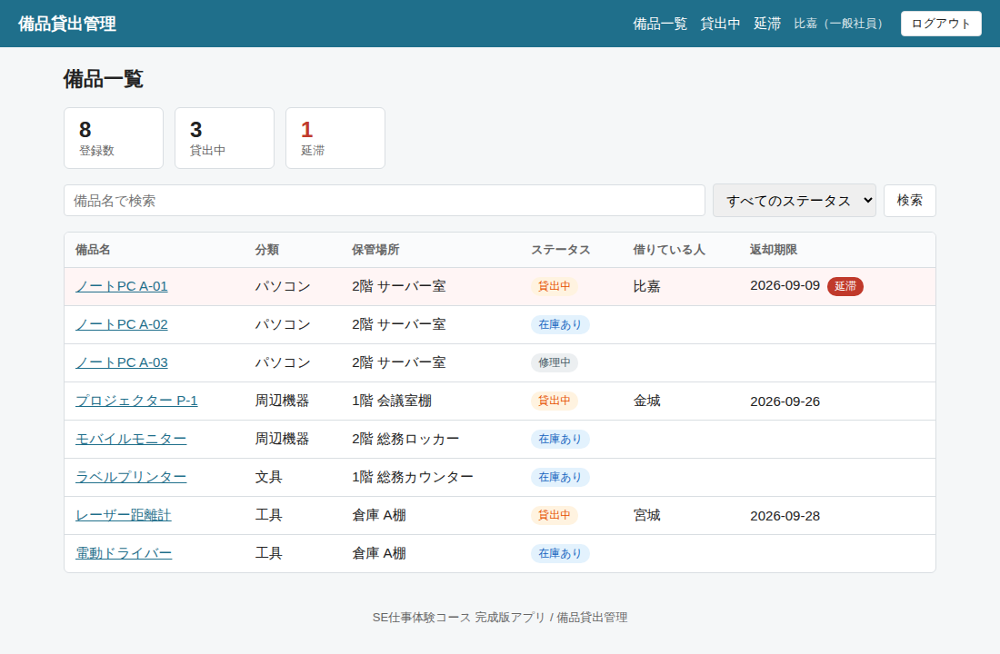
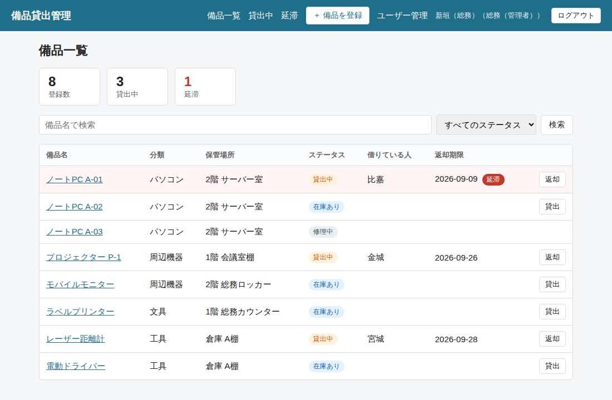

# bihin-app-login — 備品貸出管理システム（ログイン・権限つき 合体版）

[bihin-app](https://github.com/DevSOONESSorg/bihin-app)（備品貸出管理システム）に、[auth-lab](https://github.com/DevSOONESSorg/auth-lab)（ログイン教材）のログイン・権限・ユーザー管理・社員マスタAPI連携を **実際に組み込んだ結果** のリポジトリです。

組み込みの手順は **1ステップ＝1コミット** で残してあり、[docs/merge-guide.md](docs/merge-guide.md) に各ステップの説明とコミットへのリンクがあります。

- 自分の bihin-app にログインを付けたい人 → 手順書を上から順に進める（コピペで進められます）
- 自分で設計して合体させた人 → 答え合わせに使う
- 動くものをすぐ見たい人 → このリポジトリをそのまま起動する

| 一般社員でログインしたとき | 総務でログインしたとき |
|---|---|
|  |  |

---

## bihin-app との違い

| | bihin-app | bihin-app-login（このリポジトリ） |
|---|---|---|
| ログイン | なし。誰でも全操作できる | あり。未ログインでは何も見られない |
| 権限 | なし | 一般社員は閲覧のみ／総務は登録・編集・削除・貸出・返却 |
| ユーザー管理 | なし | 総務がアカウント発行・無効化・パスワードリセットできる。監査ログあり |
| 借りる人の入力 | 手入力 | 社員マスタAPIから選ぶ（APIが止まっていれば手入力に戻る） |
| サービス数 | 1（app） | 2（app + api） |
| 追加パッケージ | — | express-session、bcryptjs |

備品の機能そのもの（一覧・検索・登録・貸出・返却・延滞・履歴）は bihin-app と同じです。

---

## まず使うログイン情報（教材用）

起動したら <http://localhost:3000> を開き、次のいずれかでログインします。**パスワードはすべて `Taiken-2026`** です。

| ログインID | パスワード | 表示名 | 役割 | できること |
|---|---|---|---|---|
| `admin` | `Taiken-2026` | 新垣（総務） | 総務（管理者） | すべて。まずはこれで入る |
| `higa` | `Taiken-2026` | 比嘉 | 一般社員 | 一覧と詳細を見るだけ |
| `kinjo` | `Taiken-2026` | 金城 | 一般社員 | 初期パスワード状態（ログインすると変更を求められる） |

教材用のダミーです。実際のシステムでこのような共通パスワードを使ってはいけません。Chrome に「パスワードを保存しますか？」と聞かれたら「使用しない」で構いません。

---

## 動かし方

### 必要なもの

- Docker Desktop が起動していること
- このリポジトリ（Code → Download ZIP、または `git clone`）

### 手順

```bash
cd bihin-app-login
cp .env.example .env      # Windows は copy .env.example .env
docker compose up --build
```

次の2行が出たら起動完了です（順番は前後します）。

```
備品貸出管理 を起動しました → http://localhost:3000
社員マスタAPI を起動しました（認証方式: none） → http://localhost:3001
```

### 止め方

`Ctrl + C` のあと `docker compose down`

### データを初期状態に戻す

```bash
docker compose run --rm app npm run reset
```

`data/bihin.db` を手で削除しても同じです。備品のサンプルデータと初期ユーザーが入り直します。

### bihin-app / auth-lab と同時に動かす

このリポジトリは 3000（app）と 3001（api）を使います。bihin-app も 3000 番なので、同時に動かすときはどちらかの `.env` で `PORT` を変えてください。auth-lab（4000 / 4001）とはぶつかりません。

---

## 画面と権限の対応

| 画面 | URL | 未ログイン | 一般社員 | 総務 |
|---|---|---|---|---|
| 備品一覧・検索 | `/items` | → ログイン画面 | ○ | ○ |
| 備品詳細・履歴 | `/items/:id` | → ログイン画面 | ○ | ○ |
| 貸出中・延滞一覧 | `/loans` | → ログイン画面 | ○ | ○ |
| 備品の登録・編集・削除 | `/items/new` など | → ログイン画面 | 403 | ○ |
| 貸出・返却 | `/loans/new/:id` など | → ログイン画面 | 403 | ○ |
| ユーザー管理・監査ログ | `/admin/users` | → ログイン画面 | 403 | ○ |
| パスワード変更 | `/password` | → ログイン画面 | ○ | ○ |

一般社員には操作ボタン自体を表示していませんが、**本体の制限はルート側（`routes/` の `requireRole`）** にあります。ボタンを隠すだけでは URL を直接叩けば通ってしまうためです。

---

## フォルダ構成（bihin-app からの追加分に ★）

```
bihin-app-login/
├── README.md
├── docker-compose.yml       ← app と api の2サービス（★api を追加）
├── .env.example             ← ★SESSION_SECRET と API の設定を追加
├── docs/
│   └── merge-guide.md       ← ★合体手順書（ステップごとのコミットつき）
│
├── src/
│   ├── server.js            ← ★セッション設定、ログインルート、ユーザー管理ルートを追加
│   ├── config.js            ← ★ログイン関連と API の設定を追加
│   ├── db.js                ← ★users / audit_logs テーブルを追加
│   ├── auth/                ← ★auth-lab からコピー（ログインの本体）
│   │   ├── users.js
│   │   ├── routes.js
│   │   └── middleware.js
│   ├── lib/
│   │   └── employeeApi.js   ← ★auth-lab からコピー（社員マスタAPIを呼ぶ）
│   ├── routes/
│   │   ├── items.js         ← ★requireLogin / requireRole を追加
│   │   ├── loans.js         ← ★同上。貸出フォームで社員一覧を取得
│   │   └── admin-users.js   ← ★auth-lab からコピー（ユーザー管理）
│   └── views/
│       ├── login.ejs        ← ★auth-lab からコピー
│       ├── password.ejs     ← ★auth-lab からコピー
│       ├── admin/           ← ★auth-lab からコピー
│       ├── partials/header.ejs ← ★ログイン状態の表示、役割によるリンクの出し分け
│       ├── items/           ← ★ボタンの出し分け
│       └── loans/           ← ★ボタンの出し分け、借りる人のセレクト
│
└── api/                     ← ★auth-lab の api をそのままコピー（社員マスタAPI）
```

---

## この先の課題

このリポジトリを土台に、さらに要件変更を出せます。

| Lv | 顧客の要望 | 触るところ |
|---|---|---|
| 2 | 自分（ログイン中の人）が借りている備品だけを表示する「マイページ」がほしい | `routes/` に画面を1つ追加。`req.session.user.display_name` と `loans.borrower` を突き合わせる |
| 2 | 一般社員も「返却」だけはできるようにしたい（自分が借りたものに限る） | `loans.js` の返却ルートで、admin か「借りた本人」かを判定 |
| 3 | 借りる人を名前ではなく社員番号で保存したい（社員の改名や同姓同名に備える） | `loans` テーブルに `employee_no` を追加、既存データの移行、表示側の変更 |
| 3 | 一般社員が「貸出申請」を出し、総務が「承認」すると貸出になる流れにしたい | 状態遷移が増える（申請中 → 承認 → 貸出中）。テーブル設計から |
| 3 | 社員マスタAPIの認証を `jwt` にして、鍵を `.env` で管理したい | `.env` の `API_AUTH_MODE=jwt`。auth-lab 第3段の手順どおり |
| 4 | ログインをパスキーや Google ログインにしたい | 認証サービス（IdP）の利用。auth-lab README の補足を参照 |

---

## 使っている技術

bihin-app（Node.js 20 / Express / EJS / SQLite）に、express-session（セッション）、bcryptjs（パスワードのハッシュ）、jsonwebtoken（api 側の JWT）を加えたものです。

## ライセンス

MIT License

## 作成

株式会社SOONESS（就労継続支援A型）SE仕事体験コース
